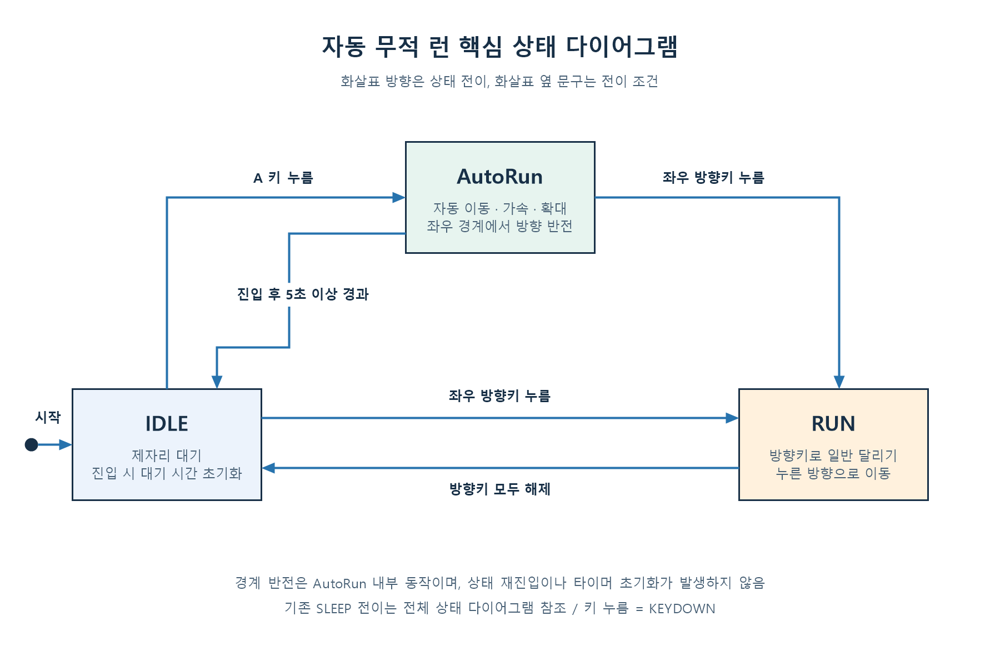
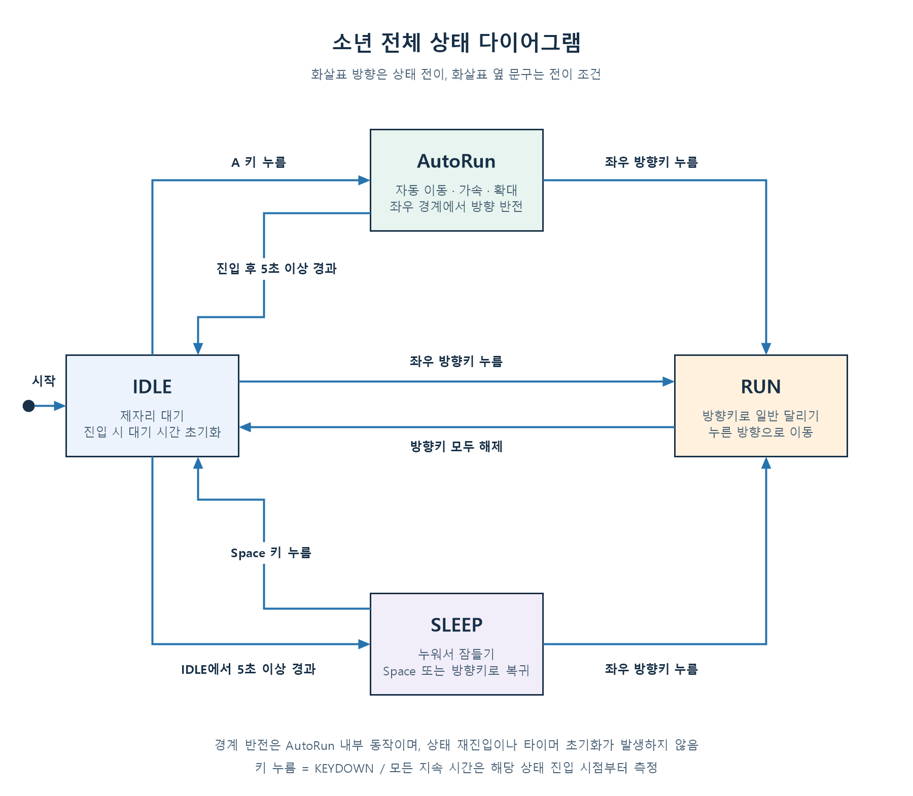

# 소년 자동 무적 런 기능 PRD 및 개발계획

- 작성일: 2026-10-28
- 기준 문서: [PRE_PRD.md](PRE_PRD.md)
- 대상 코드: `boy.py`, `boy_game.py`, `grass.py`
- 문서 상태: 구현 전 개발계획

## 1. 목표

현재 소년의 상태 머신에 `AutoRun` 상태를 추가한다. IDLE에서 A 키를 누르면 소년이 커지고 빨라지며, 조작 없이 화면 좌우를 왕복한다. 진입 후 5초 이상 지나면 IDLE로 복귀하고, 실행 중 좌우 방향키를 누르면 즉시 일반 RUN으로 전환한다.

구현은 기능 단위로 나누어 검증하고 각 단계마다 커밋한다. 이 문서 작성 단계에서는 게임 코드를 변경하거나 구현 커밋을 생성하지 않는다.

## 2. 현재 구현과 유지할 동작

| 항목 | 현재 코드에서 확인한 동작 |
| --- | --- |
| 실행 | `python boy_game.py`, pico2d 캔버스 사용 |
| 상태 관리 | `transitions.Machine`, `IDLE`·`RUN`·`SLEEP`, 초기 상태 IDLE |
| 초기 위치와 방향 | `(400, 90)`, 오른쪽 바라보기 |
| 일반 달리기 | 초당 200픽셀, 좌우 방향키 중 나중에 누른 키 우선 |
| 키 해제 | 양쪽 키 중 하나를 놓으면 남은 방향으로 이동, 모두 놓으면 IDLE |
| 화면 경계 | 일반 RUN의 중심 좌표를 `50`부터 `캔버스 너비 - 50`까지 제한 |
| 대기와 수면 | IDLE에서 5초 이상 지나면 SLEEP, Space로 IDLE 복귀, 방향키로 RUN 전환 |
| 시간 처리 | `time.monotonic()`으로 경과 시간을 측정하고 RUN 이동에 프레임 경과 시간 사용 |
| 렌더링 | 원본 스프라이트 프레임은 100×100, 방향별 대기·달리기 행 사용 |
| 종료 | ESC 또는 창 닫기 |

기존 키 우선순위, 수면 전이, 일반 달리기 속도와 종료 동작은 유지한다. README에 적힌 `test_boy.py`와 `boys_team_10000.py`는 현재 저장소에 없으므로 기존 테스트나 실행 대상으로 간주하지 않는다.

## 3. 개발 범위와 설계 가정

### 필수 범위

- IDLE에서 A 키로 AutoRun 진입.
- 입력 없이 이동하고 화면 양 끝에서 자동으로 방향 전환.
- 일반 RUN보다 빠른 이동과 큰 크기.
- AutoRun 진입 후 5초 이상 경과 시 IDLE 복귀.
- AutoRun 중 좌우 방향키를 누르면 해당 방향의 RUN으로 전환.
- AutoRun 종료 시 일반 크기와 일반 이동 동작 복원.
- 기존 상태와의 관계를 나타내는 상태 다이어그램 및 단계별 커밋.

### 원문에 수치나 세부 동작이 없는 항목의 제안값

아래 값은 PRE_PRD의 확정 요구사항과 구분되는 구현 기준 제안이다. 구현 시 상수로 관리하여 조정할 수 있게 한다.

| 항목 | 제안 기준 | 이유 |
| --- | --- | --- |
| 상태 이름 | `AutoRun` | PRE_PRD의 상태 이름과 일치 |
| 이동 속도 | 초당 400픽셀, 일반 RUN의 2배 | 속도 증가를 분명하게 확인 가능 |
| 확대 배율 | 1.5배, 출력 크기 150×150 | 확대 효과와 왕복 이동 공간 확보 |
| 지속 시간 | 5.0초 | 원문 요구사항에 따라 고정 |
| 진입 방향 | 기존 `face_dir` 유지 | 마지막으로 바라본 방향으로 자연스럽게 시작 |
| 애니메이션 | 기존 RUN 프레임 재사용, 우선 10 FPS 유지 | 별도 이미지 없이 기능 구현 |
| A 키 유효 상태 | IDLE에서만 | RUN·SLEEP·AutoRun에서는 무시하고 타이머도 재시작하지 않음 |
| 무적의 범위 | 현재 프로젝트에서는 특수 상태의 명칭과 이동·확대 효과로 표현 | 현재 코드에 적·피격·체력·충돌 판정이 없음 |

신규 적, 피해 판정, 체력, 이펙트, 사운드, 별도 UI 및 무적 시스템은 이번 범위에 포함하지 않는다. 이후 피해 시스템을 추가할 때 AutoRun의 피해 면역 여부를 연결한다.

## 4. 상세 기능 요구사항

| ID | 요구사항 | 완료 기준 |
| --- | --- | --- |
| FR-01 | IDLE에서 A 키 KEYDOWN을 받으면 AutoRun으로 전환한다. | 진입 시 프레임과 AutoRun 시작 시각을 초기화하고 기존 방향을 유지한다. |
| FR-02 | AutoRun은 방향키를 누르지 않아도 이동한다. | 이동량은 `방향 × AutoRun 속도 × 경과 시간`을 기준으로 계산한다. |
| FR-03 | AutoRun의 이동 속도와 출력 크기를 늘린다. | 제안 기준으로 속도 400픽셀/초, 크기 150×150이 적용되며 원본 이미지의 클립 영역은 100×100을 유지한다. |
| FR-04 | 확대된 소년이 화면 좌우 끝에 도달하면 반대 방향으로 이동한다. | 확대된 출력 폭을 반영한 경계를 사용하고 이동 방향과 스프라이트 방향이 일치한다. |
| FR-05 | AutoRun에서 5초 이상 지나면 IDLE로 돌아간다. | 5초 미만에는 유지하고, 최초로 경과 시간이 5초 이상인 업데이트에서 전환한다. |
| FR-06 | AutoRun 중 좌우 방향키 KEYDOWN은 RUN으로 전환시킨다. | 누른 방향으로 일반 RUN을 시작하고 키 해제 시 기존 규칙대로 동작한다. |
| FR-07 | AutoRun 종료 후 일반 크기를 사용한다. | IDLE·RUN·SLEEP 렌더링에 확대 크기가 남지 않는다. |
| FR-08 | 기존 상태 동작을 유지한다. | IDLE → SLEEP, SLEEP → IDLE/RUN, 일반 RUN 입력 처리와 종료가 정상 동작한다. |

### 경계와 표시 기준

- AutoRun의 중심 좌표 경계는 `출력 폭 / 2`와 `캔버스 너비 - 출력 폭 / 2`로 계산한다. 기본 제안값에서는 `75`와 `캔버스 너비 - 75`다.
- 경계 근처에서 AutoRun에 진입하면 확대된 몸이 화면을 벗어나지 않도록 중심 좌표를 먼저 보정한다. 바깥쪽을 바라보고 있다면 다음 이동에서 안쪽으로 반전한다.
- 경계를 넘은 이동 거리는 반사하여 반영한다. 큰 프레임 간격으로 여러 번 경계를 통과하는 경우에도 최종 위치가 경계 안에 있고 방향이 일관되도록 처리한다.
- 확대 시 발의 높이가 기존과 같도록 출력 중심의 Y 좌표를 `(확대 높이 - 기본 높이) / 2`만큼 올린다. 기본 좌표 `self.y`는 유지하여 종료 후 위치가 누적해서 달라지지 않게 한다.
- 그림은 이동 결과의 `face_dir`에 맞는 달리기 행을 사용한다.

### 입력과 타이머 기준

- AutoRun 타이머와 기존 IDLE 수면 타이머는 별도로 관리한다. AutoRun 진입 시 기존 IDLE 대기 시간은 이어받지 않는다.
- AutoRun → IDLE 시 `_enter_idle()`에서 수면 대기 시간을 새로 센다. 이후 입력 없이 다시 5초가 지나야 SLEEP으로 전환한다.
- AutoRun 중 A·Space·방향키 KEYUP만으로 상태가 바뀌지 않는다. 방향키 KEYUP 처리는 필요한 키 목록 정리에만 사용한다.
- AutoRun에서 방향키로 빠져나올 때 해당 키를 `held_keys`에 반영하여, 바로 이어지는 KEYUP 및 양쪽 방향키 입력이 기존 규칙을 따른다.
- 기존 게임 루프처럼 이벤트를 먼저 처리하고 업데이트한다. 같은 프레임에 방향키 입력과 5초 만료가 겹치면 방향키에 의한 RUN 전환을 우선한다.
- AutoRun 진입과 RUN 복귀 시 이동 기준 시각을 갱신하여 이전 상태에서 보낸 시간이 첫 이동량에 포함되지 않게 한다.
- 모든 지속 시간은 프레임 수나 시스템 날짜 대신 `monotonic()` 경과 시간으로 판정한다. 업데이트 지연 시 실제 전환은 다음 업데이트에서 이루어진다.

## 5. 상태 다이어그램

핵심 세 상태의 관계는 다음과 같다. AutoRun에서 IDLE로 돌아온 뒤에는 기존 수면 규칙도 다시 적용된다.



이미지 파일: [state_diagram_core.png](docs/images/state_diagram_core.png)

기존 SLEEP을 포함한 전체 전이 관계는 다음과 같다. 경계 반전은 AutoRun 내부 처리이며 상태를 재진입하거나 타이머를 초기화하지 않는다.



이미지 파일: [state_diagram_full.png](docs/images/state_diagram_full.png)

이미지는 프로젝트 폴더에서 다음 명령으로 다시 생성할 수 있다. 실행 정책 옵션은 해당 PowerShell 프로세스에만 적용된다.

```powershell
powershell -NoProfile -ExecutionPolicy Bypass -File .\docs\create_state_diagrams.ps1
```

## 6. 코드 변경 계획

| 대상 | 변경 내용 |
| --- | --- |
| `boy.py` 상수 | AutoRun 속도·배율·지속 시간 및 필요 시 기본 프레임 크기 정의 |
| `Boy.__init__()` | AutoRun 상태와 진입 콜백, 진입·만료·RUN 복귀·내부 갱신 전이 등록 |
| `Boy.handle_event()` | A 키 입력과 상태별 유효성 처리, 기존 방향키 목록과 RUN 복귀 연결 |
| `Boy.update()` | AutoRun 분기 추가, 만료 조건을 이동 갱신보다 먼저 검사 |
| AutoRun 전용 메서드 | 시작 시각 기록, 경과 시간 판정, 자동 이동·경계 반사·애니메이션 갱신 |
| `Boy.draw()` | RUN 스프라이트 재사용, AutoRun 출력 크기·발 높이 보정 |
| `test_boy.py` 신규 | 그래픽 창 없이 시간·입력·상태·경계·그리기 인자를 검증하는 회귀 테스트 |
| `README.md` | A 키 조작, 제안값의 실제 적용 수치, 전체 상태도와 테스트 실행법 반영. 존재하지 않는 파일 안내 정리 |
| `boy_game.py`, `grass.py` | 현행 루프와 배경을 재사용하며 기능상 필요한 경우에만 변경 |

`transitions.Machine`과 기존 명시적 전이 방식을 유지한다. AutoRun의 애니메이션 및 이동 갱신은 내부 전이로 처리하여 시작 시각이 매 프레임 재설정되지 않도록 한다. 불필요한 라이브러리나 새 게임 이미지 자산은 추가하지 않는다. 상태 다이어그램 PNG는 문서용 파일로 별도 관리한다.

## 7. 단계별 구현 및 커밋 계획

구현을 10단계로 나누고, 각 단계는 아래 완료 조건을 확인한 뒤 별도 커밋한다. 커밋 메시지는 한국어 제안이며, 단계마다 실행 가능한 상태를 유지한다. 문서 작성 완료 후 실제 구현을 진행할 때 적용하는 순서다.

| 단계 | 작업 | 단계 완료 조건 | 제안 커밋 메시지 |
| --- | --- | --- | --- |
| 1 | `test_boy.py`에 이미지·캔버스·시계 대체 환경을 만들고 기존 상태 동작 검증 | 일반 RUN의 키 우선순위와 IDLE/SLEEP 전이 테스트 통과, 변경 전 기준 확보 | `테스트: 기존 소년 상태 동작과 검증 환경 추가` |
| 2 | AutoRun 속도·배율·지속 시간 상수와 상태·진입 콜백 등록 | 초기 상태는 IDLE 유지, 테스트에서 AutoRun 진입 시 프레임·시작 시각 초기화 확인. 사용자 A 키 입력은 아직 연결하지 않음 | `기능: 자동 무적 런 상태와 설정값 추가` |
| 3 | AutoRun 전용 갱신 분기와 5초 만료 전이 구현 | 테스트에서 AutoRun에 진입시켜 4.999초 유지·5초 이상 IDLE 복귀 및 수면 타이머 재시작 확인 | `기능: 자동 무적 런의 5초 종료 처리 추가` |
| 4 | AutoRun에서 방향키로 RUN 복귀하는 입력 처리 구현 | 양쪽 방향키 각각 RUN 전환, 입력 목록 반영, KEYUP·동시 입력 우선순위 검증 통과 | `기능: 방향키 입력 시 일반 달리기로 복귀` |
| 5 | IDLE의 A KEYDOWN을 AutoRun 진입 전이에 연결하고 입력 유효 범위 제한 | IDLE에서만 A로 진입, 다른 상태의 A 및 AutoRun의 Space·KEYUP은 전이 없음, 반복 A로 시간 연장 없음 | `기능: 대기 상태에서 A 키로 자동 무적 런 시작` |
| 6 | 확대 출력 폭 기준 경계 계산, 진입 좌표 보정 및 경계 반사 로직 구현 | 양 끝 도달·초과, 바깥 방향 진입, 여러 왕복 구간의 큰 이동량에 대한 위치·방향 검증 통과 | `기능: 자동 무적 런의 화면 경계 반사 처리 추가` |
| 7 | AutoRun에 초당 400픽셀 자동 이동과 시간 기반 달리기 애니메이션 연결 | 무입력 0.5초에 200픽셀 이동, 양 끝에서 반복 왕복, 진입 직후 이전 상태 시간이 이동량에 섞이지 않음 | `기능: 자동 무적 런의 가속 이동과 애니메이션 추가` |
| 8 | AutoRun 출력 크기 150×150, 방향별 프레임, 발 높이 보정 및 일반 크기 복귀 구현 | 그리기 인자 테스트 통과, 실제 화면에서 확대·방향 전환·IDLE/RUN 복귀 시 크기와 발 높이 확인 | `기능: 자동 무적 런 확대 표시와 기본 크기 복원` |
| 9 | 전체 입력·타이머 조합의 통합 회귀 테스트와 실제 실행 검증, 발견한 결함 수정 | AC-01~AC-13 검증 완료, 만료와 방향키의 같은 프레임 처리 및 기존 수면·종료 동작 확인 | `테스트: 자동 무적 런 통합 동작과 기존 기능 회귀 검증` |
| 10 | README 조작법·실제 수치·검증 명령 정리, 별도 상태도 이미지와 문서의 일치 확인 | 실행·테스트 안내가 실제 파일과 일치, 두 상태도 PNG의 전이·한글 표시 확인, 최종 검증 결과 기록 | `문서: 자동 무적 런 조작법과 상태도 및 검증 결과 정리` |

기능 테스트는 해당 기능을 추가하는 단계에 함께 작성한다. 2~4단계에서는 테스트가 등록된 전이를 호출하여 준비 중인 상태를 검증하고, 종료·복귀 경로를 갖춘 5단계에서 사용자 입력을 연결한다. 이동을 켜기 전에 6단계에서 경계 처리를 검증한다. 9~10단계에서 결함이 발견되면 수정과 검증을 먼저 완료하고, 실제 변경 내용에 맞게 별도 수정 커밋을 남긴다. 모든 기능을 한 번에 구현한 뒤 커밋만 나누는 방식으로 진행하지 않는다.

## 8. 검증 계획 및 수용 기준

자동 테스트는 pico2d 이미지 로딩·캔버스 크기를 대체하고 `boy.monotonic`에 제어 가능한 시계를 사용한다. 실제로 5초씩 기다리지 않고 경계 시점과 상태별 동작을 검증한다.

| 검증 ID | 상황 | 기대 결과 | 방법 |
| --- | --- | --- | --- |
| AC-01 | IDLE에서 A KEYDOWN | AutoRun 진입, 기존 방향 유지, 시작 시각 초기화 | 자동 + 수동 |
| AC-02 | RUN·SLEEP·AutoRun에서 A KEYDOWN | 상태 유지, AutoRun 중에는 시작 시각도 유지 | 자동 |
| AC-03 | AutoRun에서 무입력으로 0.5초 이동 | 경계에 닿지 않는 조건에서 200픽셀 이동, 일반 RUN은 같은 시간에 100픽셀 이동 | 자동 |
| AC-04 | 왼쪽·오른쪽 경계에 도달하거나 초과 | 출력 폭 기준 경계 안에 위치하고 방향과 그림이 반전 | 자동 + 수동 |
| AC-05 | 경계 근처에서 진입하거나 한 업데이트의 이동량이 여러 왕복 구간을 통과 | 화면 안의 유효 위치와 일관된 방향 유지 | 자동 |
| AC-06 | AutoRun 진입 후 4.999초, 5.000초, 5초를 넘긴 최초 업데이트 | 4.999초에는 유지, 5.000초 이상에는 IDLE 복귀 | 자동 |
| AC-07 | AutoRun 중 왼쪽 또는 오른쪽 KEYDOWN 후 KEYUP | 누른 방향으로 일반 RUN, 모든 방향키 해제 시 IDLE | 자동 + 수동 |
| AC-08 | AutoRun에서 RUN 복귀 후 양쪽 키 입력·해제 | 나중에 누른 방향 우선, 그 키를 놓으면 남은 방향으로 이동 | 자동 |
| AC-09 | AutoRun 중 A 반복 입력·Space·방향키 KEYUP | 종료나 지속 시간 연장 없이 AutoRun 유지 | 자동 |
| AC-10 | AutoRun의 draw 및 IDLE/RUN 복귀 후 draw | AutoRun만 150×150, 발 높이 유지, 복귀 후 기본 100×100 | 자동 + 수동 |
| AC-11 | AutoRun 시간 만료로 IDLE 복귀 후 대기 | 복귀 시점부터 새로 5초가 지나야 SLEEP | 자동 |
| AC-12 | 일반 이동·수면·깨우기·종료 조작 | 기존 동작 유지, ESC와 창 닫기로 정상 종료 | 자동 + 수동 |
| AC-13 | 5초 만료와 방향키 입력이 같은 프레임에 발생 | 이벤트 우선 순서에 따라 RUN으로 전환 | 자동 |

구현 후 검증 명령:

```powershell
python -m pip install -r requirements.txt
python -m unittest test_boy.py
python boy_game.py
```

`test_boy.py`는 개발 단계에서 새로 만들 파일이며 현재는 위 테스트 명령을 실행할 수 없다. 실제 창에서는 좌우 양쪽에서 진입·반전·방향키 복귀를 확인하고, 확대 시 화면 밖으로 나가거나 발 위치가 흔들리지 않는지 확인한다.

## 9. 완료 정의

- FR-01~FR-08과 AC-01~AC-13을 충족한다.
- 핵심 상태도와 전체 상태도가 실제 전이와 일치한다.
- 기존 IDLE·RUN·SLEEP 기능에 회귀가 없다.
- 기능별 검증과 단계별 커밋 이력이 남아 있다.
- README의 조작법·실제 수치·실행 및 테스트 안내가 구현과 일치한다.
- 최종 결과에 구현 내용, 테스트 결과, 수동 확인 여부와 남은 제한을 기록한다.
