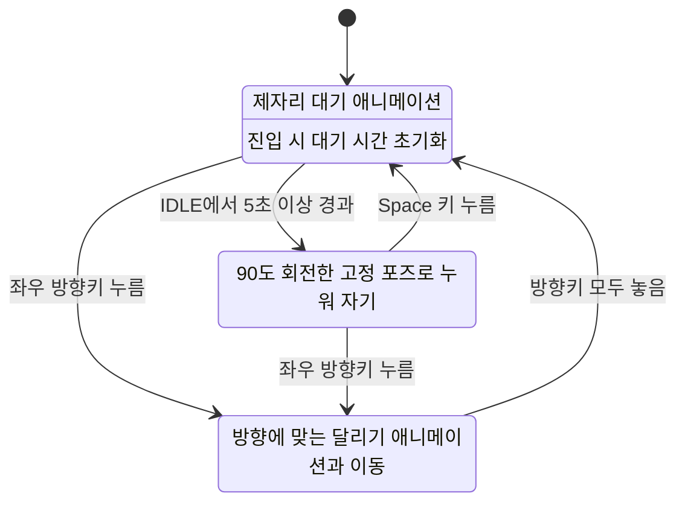

# Boy: IDLE / RUN / SLEEP

## 실행

이 폴더에서 다음 명령을 실행합니다.

```powershell
python -m pip install -r requirements.txt
python boy_game.py
```

소년은 `(400, 90)`에서 시작합니다. 좌우 방향키를 누르고 있으면 해당 방향으로
달리고, 키를 모두 놓으면 IDLE로 돌아갑니다. 두 방향키를 함께 누르면
나중에 누른 방향을 따르며, 그 키를 놓으면 아직 누르고 있는 방향으로 달립니다.
이동 속도는 초당 200픽셀이며 화면 밖으로 나가지 않습니다.

IDLE에서 5초 이상 지나면
SLEEP 상태로 바뀌어 누워서 잡니다. Space 키를 누르면 IDLE로 돌아가고
5초 대기 시간을 다시 셉니다. IDLE 중 Space 입력은 무시합니다.
ESC 또는 창 닫기로 종료합니다. `boys_team_10000.py`에서도 동일하게 동작합니다.

## 상태 그림



`transitions.Machine`에 `IDLE`, `RUN`, `SLEEP` 세 상태를 등록합니다.
`Boy.update()`가 `idle_tick()`을 호출하면 시간 조건을 먼저 검사하고,
5초 미만일 때만 내부 전이(`dest=None`)로 IDLE 애니메이션을 갱신합니다.
시간은 프레임 수가 아닌 `time.monotonic()`으로 측정합니다.
`Boy.handle_event()`가 SLEEP 중 Space 입력을 받으면 `wake_up()`을 호출합니다.
SLEEP은 스프라이트 한 프레임을 90도 회전하여 지면 가까이에 그립니다.
잠든 동안 좌우 방향키를 누르면 즉시 RUN으로 전환하여 해당 방향으로 달립니다.
달리기 이동량과 애니메이션은 실제 프레임 경과 시간으로 계산합니다.
달리기를 멈추면 그 시점부터 IDLE의 5초 대기 시간을 새로 셉니다.

검증: 이 폴더에서 `python -m unittest test_boy.py`를 실행합니다.

참고: [transitions 공식 문서](https://github.com/pytransitions/transitions#conditional-transitions)
